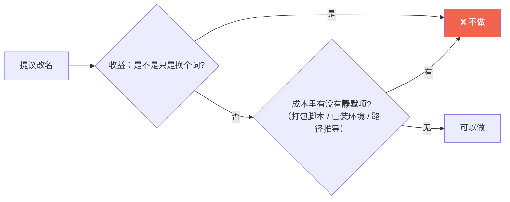

# AI 项目工程化分区 SOP

## 何时用

需求信号：「目录感觉不太一样」「是不是该有 core / log 之类的分区」「这是 AI 项目，得有大模型管理」
「文档要更友好、更多、学习向」「加 mermaid 图解」「演示视频链到 README」。

**先判断**：这是**产品型**仓库（有可看产出）还是纯代码库？纯代码库不需要 demo/ 与学习中心。

---

## 0 · 四条平台事实（实测，别重复试错）

1. **GitHub 的 `<video>` 标签会被 Markdown 清洗器整个剥掉。**
   复现：`gh api -X POST /markdown -f mode=gfm -f context=<owner>/<repo> -f text='<video controls src="a.mp4"></video>'`
   → 返回 `<p dir="auto"></p>`。⚠️ 该接口返回 **HTML 文本**，**不要加 `--jq`**。
2. **仓库里唯一「打开就动」的形态只有 GIF**（`` 渲染成坏图，点 mp4 只给下载按钮）。
   → README 的正确形态：**GIF 自动播 + 点图链到 mp4 文件页**；想"点一下就播带声音"只能靠**仓库自带的本地播放器** `demo/index.html`。
3. **GIF 自动播放不是无条件的**：读者开了「减少动态效果」会停在第一帧 → **首帧必须本身是合格封面**。
4. **GitHub 原生渲染 mermaid**（` ```mermaid ` 围栏）。本地 MD 阅读器不一定渲染 → 关键图**附一个纯文本折叠块兜底**（`<details>`）。

> `gh` 常不在沙箱 PATH → 用 `/opt/homebrew/bin/gh` 绝对路径。

---

## 1 · 分区判据（一句话：**这个目录里会不会红**）

| 会不会红 | 目录 | 说明 |
|---|---|---|
| **会红** | `tests/` | 可回归**判据**。纯标准库优先（守护不该有依赖）；退出码要能用 |
| 会量 | `tools/` | 一次性**量具**：探针 / 基准 / 剖析 / 预览 |
| 讲道理 | `doc/` | 选型 / 决策 / 踩坑 |
| 会变的资产 | `prompts/` `models/` | 提示词 / 模型台账 —— **单独成目录，别混进代码** |
| 每次再生 | `cache/` `logs/` | gitignore，但**留一个 README 说明约定** |

**三个 AI 项目特有缺口**（普通项目没有，逐个补）：

| 目录 | 补什么 | 关键约束 |
|---|---|---|
| `models/` | 模型**台账**：用哪个 / 换模型 SOP / 降级路径 / 红线 | ⚠️ **不存权重**（在 `~/.ollama/models`）。与代码里的 `models.py`（数据契约）同名不同层 → README 里显式澄清 |
| `logs/` | 运行日志 | **默认不写盘**。理由：日志会记输入路径/章节标题（与"内容不出本机"承诺有张力）、`.app` 的 Resources 理论只读、用户不会去删 |
| `tests/` | 从 `tools/` 分出 `verify_*` | 混住的真实代价**不是难看，是没人说得清哪些必须绿 → 结果都不跑** |

---

## 2 · `logs/` 的最小实现（零依赖，零调用点改动）

不要用 `logging` 改造全项目（要改十几个调用点，只换来一个用不上的 level）。
挂 `sys.stdout` 的 Tee 即可：

```python
class _Tee:
    def __init__(self, *streams): self._streams = streams
    def write(self, d):
        for s in self._streams: s.write(d)
        return len(d)
    def flush(self):
        for s in self._streams:
            if hasattr(s, "flush"): s.flush()
    def isatty(self): return False      # ⚠️ 必须实现，否则某些库走进"无终端"分支
```

- 用 argparse 的 **`parents=[common]`** 把 `--log-file` 挂到子命令（这样能写在子命令**之后**，符合习惯）。
- 日志头写 **时间戳 + 完整命令行** —— 排查时第一个问题就是"当时跑的是哪条"。
- `finally` 里 `flush()` + `close()`，**不关会丢尾巴**（最难查的那种"日志不完整"）。
- `.gitignore` 用 `logs/*` + `!logs/.gitkeep` + `!logs/README.md`（⚠️ gitignore **不支持行内注释**）。

---

## 3 · 教学层 `doc/learn/`（想让人"学得会"时建）

**铁律：只翻译已有结论，不下新结论。**
在 `learn/` 里下结论 = 立刻产生第二个没人维护的事实源（多副本漂移）。

- 与 `doc/` 的分工写进两边 README：**`doc/` 是结论的产地，`doc/learn/` 是结论的译本。**
- 每篇固定结构：**学完你能回答**（一句话目标）→ 正文（比喻 + mermaid）→ **能跑的命令** → 延伸阅读（指针）。
- 5 篇起步：① 项目工程化 ② 大模型与本地推理 ③ 提示词即资产 ④ 确定性与缓存 ⑤ 动手实验。
- **实验必须真的能跑**：先 `ls` 确认样例文件存在，再写进文档（血泪：文档里写的文件根本不存在）。

---

## 4 · 改名裁决框架（遇到 `src/→core/` 这类提议时按这个走）



常见裁决（Python 项目）：

- **`src/ → core/`：不做。** `src/` 是 setuptools 官方推荐的 src-layout；`core/` 的价值在于**和别的层区分**（core vs plugin），
  只有一个包时**没有对比项的名字是空的**；而 `pyproject` 的 `package-dir`、`build_*.sh` 拷贝逻辑、已安装 venv 的 egg-link
  是**静默**风险（测不出来，只在某次打包时炸）。
- **`doc/ → docs/`：不做。** 几十处链接，收益仅"更常见"。

> **原则：目录的价值在边界清晰，不在名字好听。** 边界用一张分区表写清楚就够了。
> 裁决要**把反方理由一起写进文档**，否则后人不知道当时权衡了什么。

---

## 5 · 迁移时的自检查（每次动目录必过）

```bash
# ① 用 git mv 保历史；② 全局改引用（Grep 工具，别用 bash grep —— 沙箱里会假阴性）
# ③ 历史档案（specs/、CHANGELOG/）保持原样 —— 它们是时点记录，改了才是漂移
# ④ 逐条跑一遍迁过去的脚本
for t in deps icons prompt cache segmenter; do python tests/verify_$t.py || echo "🔴 $t"; done
```

- 脚本里的 `Path(__file__).resolve().parents[N]`：**同深度改名才安全**（`tools/` → `tests/` 都是 1 层，安全）。
- 迁完**逐条实跑** —— 长期没人跑的守护脚本默认当成**坏的**（实证：8 条里就有 1 条一直是坏的）。

---

## 6 · 常见翻车

| 现象 | 真因 |
|---|---|
| README 里的视频点开是下载 | `<video>` 被 GitHub 剥掉 → 只能用 GIF + 链接 |
| `gh api POST /markdown` 报 `invalid character '<'` | 返回是 HTML 文本，**别加 `--jq`** |
| 文档里的样例文件不存在 | 写了没核实 → 写实验前先 `ls` |
| 守护脚本在本机永远为红 | 断言的是**环境状态**不是**行为变化** → 改成「跑前/跑后快照比对」 |
| bash `grep` 搜不到明明存在的引用 | 沙箱里 bash grep 会假阴性 → 用 Grep 工具或 Python 扫 |
| mermaid 在 GitHub 之外不渲染 | 正常 → 关键图附 `<details>` 纯文本版兜底 |

<!-- public-sync: 2026-10-12 | 脱敏版本 | 源 ~/.workbuddy/skills/ai-repo-engineering-layout -->
