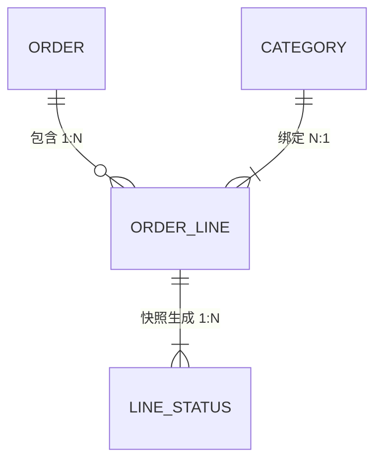

> 生成时间：{YYYY-MM-DD} | 最后更新：{YYYY-MM-DD}
> 所属：科码 AI 技能项目 / `ubiquitous-language` 技能模板
> 用途：业务本体的四张表（对象 / 关系 / 动作 / 规则）的字段定义、填写示例与写法纪律
> 说明：示例一律**抽象化**（订单 / 物料 / 审批这类通用词），不绑定任何真实客户业务

# 本体数据模型（四张表）

## 〇、为什么是这四张

| 问题 | 词表能答吗 | 本体怎么答 |
|------|:--:|-----------|
| 这个词什么意思 | ✅ | 对象表 · 定义列 |
| 它由什么构成 | ❌ | 对象表 · 关键属性列 |
| 它和谁有关系 | ❌ | **关系表** |
| 谁能对它做什么 | ❌ | **动作表** |
| 什么不能做 | ❌ | **规则表** |
| 这条能不能对外说 | ❌ | 每张表的置信度列 |

> **一句话**：词表回答「这个词什么意思」，本体回答「这个世界的骨架长什么样」。
> 四张表缺任何一张，都会退回成词表——**关系表和动作表是本体与词表最大的差别**。

---

## 一、对象类型（Object Types）

### 字段定义

| 字段 | 说明 | 必填 |
|------|------|:--:|
| 对象 | 标准名称（英文优先，与系统/代码用词一致） | ✅ |
| 中文 | 中文名（与界面/文档用词一致） | ✅ |
| 定义 | **一句话，独立可读**——不出现「见 XX 文档」「同上」 | ✅ |
| 关键属性 | 由什么构成（属性级，不是字段级全量） | ✅ |
| 数据载体 | 存放位置（表名 / 文件 / 只是某字段）。**现状 → 目标**各写一份 | ⬜ |
| 置信度 | 🟢 / 🟡 / 🔴 | ✅ |
| 出处 | `文件:行` 或 `文件 §节` | ✅ |

### 填写示例（抽象）

| 对象 | 中文 | 定义 | 关键属性 | 数据载体（现状 → 目标） | 置信度 | 出处 |
|------|------|------|---------|----------------------|:--:|------|
| Order | 订单 | 一次客户采购意向的聚合根，全局唯一编号 | OrderNo(PK)、Customer、Status、Amount、CreatedBy | `order`（原表名未确认 → 目标设计 ER） | 🟡 | 需求 §6.1 |
| Order Line | 订单行 | 订单下的一条商品明细，**进度跟踪的实际粒度** | LineNo、SkuCode、Qty、UnitPrice | `order_line`（推断） | 🔴 | 需求 §6.6 |
| Order Status | 订单状态 | 值对象/枚举：控制订单是否可写 | `DRAFT` / `CONFIRMED`（全量枚举 [待确认]） | `order.status` | 🟡 | 设计 §状态机 |
| Customer | 客户 | 下单方；**在产品里只是 `order.customer` 文本字段，不是独立实体表** | 客户名 | `order.customer` | 🟡 | 设计 §ER |

### 写法纪律

| 规则 | 反例 → 正例 |
|------|-----------|
| **定义必须独立可读** | 「订单的明细，详见 §6」 → 「订单下的一条商品明细，是进度跟踪的实际粒度」 |
| **"不是实体表"要说出来** | 只写 `order.customer` → 写明「只是文本字段，无独立主数据表 → 无法做客户维度关联查询」 |
| **粒度写清** | 「订单明细」 → 「**进度跟踪的实际粒度**」（读者据此知道该看哪一层） |
| **值对象也进表** | 只收实体 → 状态枚举、顺序号这类值对象单列一行，标「值对象/枚举」 |
| **表名不确定就标推断** | 直接写 `order_line` → `order_line`（推断）+ 置信度降级 |

> **一眼判断粒度对不对**：定义里如果能读出「谁在什么颗粒度上做事」，就对了；只读出「一个 XXX」，太粗。

---

## 二、关系（Links）

### 字段定义

| 字段 | 说明 | 必填 |
|------|------|:--:|
| 编号 | `L-01` 递增，便于引用与变更追踪 | ✅ |
| 源对象 / 目标对象 | 参与关系的两个对象（必须是对象表里有的） | ✅ |
| 关系 | **动词短语**（包含 / 绑定 / 授予 / 跟踪），不是「关联」这类空词 | ✅ |
| 基数 | `1:1` / `1:N` / `N:M` | ✅ |
| 说明 | **业务语义**——为什么这样连；有反常之处（快照、覆盖写入）必须写明 | ✅ |
| 置信度 / 出处 | 同上 | ✅ |

### 填写示例（抽象）

| # | 源对象 | 关系 | 目标对象 | 基数 | 说明 | 置信度 | 出处 |
|:--:|--------|------|----------|:--:|------|:--:|------|
| L-01 | Order | 包含 | Order Line | 1:N | 一单多行，行是进度跟踪粒度 | 🟢 | 设计 §ER |
| L-02 | Order Line | 归属 | Category | N:1 | 每行绑定一个类别，决定其工序流 | 🟢 | 需求 §6.6 |
| L-03 | Order Line | 跟踪 | Line Process Status | 1:N | **快照关系**：创建瞬间复制生成，此后不联动 | 🟢（行为）／🔴（是否真快照） | 需求 §5.5 |
| L-04 | User | 操作 | Line Process Status | 1:N | 操作人**覆盖写入**当前登录用户，非追加 | 🟢 | 设计 §Service |

### 写法纪律

| 规则 | 说明 |
|------|------|
| **关系名必须是动词** | 「订单明细关联」→「订单 **包含** 订单行」。写不出动词，说明这条关系还没想清 |
| **基数必填** | 缺基数 = 读者无法判断能不能多对多 |
| **反常关系要标注** | 快照、覆盖写入、软引用、冗余字段——这类"看起来该联动其实不联动"的，**说明列加粗写出来**（这是最容易在重构时改错的地方） |
| **两端都必须在对象表里** | 关系指向一个不在对象表里的东西 → 要么补对象，要么改关系 |
| **拆开标置信度** | 「关系存在 🟢 / 存储形态 🔴」——同一行的这两个判断经常强度不同，**分开标** |

> **一张关系表值不值钱，看"说明"列**：只有「1:N」三个字的是废表；写明"为什么这样连、什么情况下不连"的才有用。

---

## 三、动作（Actions）

### 字段定义

| 字段 | 说明 | 必填 |
|------|------|:--:|
| 编号 | `A-01` 递增 | ✅ |
| 动作 | **动词短语**（创建订单 / 回录工序状态） | ✅ |
| 主体 | **谁做**（角色，不是人名；系统自动写 `SYS`） | ✅ |
| 作用对象 | 操作哪个对象（必须是对象表里有的） | ✅ |
| 前置 → 后置效果 | 什么状态下可做 → 做完系统变成什么样 | ✅ |
| 置信度 / 出处 | 同上 | ✅ |

### 填写示例（抽象）

| # | 动作 | 主体 | 作用对象 | 前置 → 后置效果 | 置信度 | 出处 |
|:--:|------|------|----------|----------------|:--:|------|
| A-01 | 创建订单 | 客服 / 管理员 | Order | 编号全局唯一（否则 `ORDER_NO_DUPLICATE 10008`） → 落库为 `DRAFT` | 🟢 | 需求 §6.3 |
| A-02 | **添加订单行 → 触发行级快照生成** ⭐ | 客服 / 工程师 | Order Line → Line Process Status | 订单存在且为 `DRAFT`；行号同单内唯一 → 插 1 行 + **N 行状态记录**（N = 该类别工序数，初始未开始） | 🟢 | 设计 §Service.create（关键业务动作） |
| A-03 | 回录工序状态 | 工程师（现场） | Line Process Status | 订单未 `CONFIRMED` → 逐条更新；操作人 = 当前登录用户；**批量部分失败整体回滚** | 🟢 | 设计 §Service.batchUpdate |
| A-04 | 数据迁移 | 系统 | 全对象 | 幂等、演练 ≥1 次 → 全量历史迁移；异常有明细日志与回滚 | 🟢（要求）／🔴（原 schema） | 需求 §11 |

### 写法纪律

| 规则 | 说明 |
|------|------|
| **主体必填** | 「回录工序状态」不写主体 = 不知道谁有权限做。主体写**角色**，不写人名 |
| **前置条件写"拦什么"** | 写清不满足时系统给什么反应（错误码 / 拒绝 / 静默忽略）——这是规则表的来源 |
| **后置效果写"系统变成什么样"** | 不是"操作成功"，而是"订单转只读""生成 N 行记录""写审计" |
| **主链动作标星** | 最关键的那个动作（触发下游生成、改变全局状态的）用 ⭐ 标出来，读者一眼看到 |
| **副作用要写出来** | 一次动作连带生成/删除/冻结了什么（如"删订单沿包含关系级联"），语义不明就标 `[待确认]` |

> **自检**：动作表读完，能不能回答「这个角色在这个系统里一天做了什么」？不能 → 动作没收全。

---

## 四、业务规则（Rules）

### 字段定义

| 字段 | 说明 | 必填 |
|------|------|:--:|
| 编号 | `R-01` 递增；**系统已有错误码的，优先复用错误码**（如 `ORDER_NO_DUPLICATE`） | ✅ |
| 规则 | 一句话：**什么不能做 / 必须满足什么** | ✅ |
| 触发场景 | 什么时候会撞上这条规则 | ✅ |
| 违反后果 | 系统行为：报错码 / 拒绝 / 静默修正 / 数据失真 | ✅ |
| 置信度 / 出处 | 同上 | ✅ |

### 填写示例（抽象）

| 编号 | 规则 | 触发场景 | 违反后果 | 置信度 | 出处 |
|------|------|---------|---------|:--:|------|
| R-01 | **快照语义**：行创建时按类别工序序列即时生成状态记录；此后模板变更不影响已生成记录 | 改类别工序序列 / 看历史订单 | 历史订单进度被静默改写（数据失真） | 🟢（设计要求）／🔴（原系统实际行为） | 需求 §5.5 |
| R-02 | 订单编号全局唯一 | 创建订单 | `ORDER_NO_DUPLICATE 10008` | 🟢 | 需求 §6.5 |
| R-03 | 确认后只读：订单及其行状态不可再写 | 任何写操作 | 抛 `ORDER_STATUS_INVALID 10010` | 🟢 | 设计 §状态机 |
| R-04 | 顺序号在同一父对象下从 1 连续递增，调序后自动重排 | 配置序列 | 乱序/重复 → 快照生成冲突、排序不确定 | 🟢（要求）／🔴（原库是否有唯一约束） | 需求 §5.3 |

### 写法纪律

| 规则 | 说明 |
|------|------|
| **一句话能读懂** | 「关于订单编号的一些约束」→「订单编号全局唯一」 |
| **必须有后果** | 没写违反后果的规则 = 读者不知道要不要在意 |
| **错误码照抄** | 用系统既有错误码，**不另造编号体系**——两套编号必然对不上 |
| **"应该是"和"实际是"分开标** | 设计要求 🟢 + 原系统实际行为 🔴，是两条独立判断，**不要合成一个数字** |
| **迁移类规则单独收** | 大小写敏感性、软删除 vs 物理删除、collation 差异——这类"新旧行为不等价"的坑单列，重构时第一个要看 |

---

## 五、置信度：写进每一行

| 标记 | 含义 | 判据 | 用途 |
|:--:|------|------|------|
| 🟢 | 已实测 / 客户原话 | 有可指认的一手来源（逐字稿行、原系统页面、命令输出） | 可直接对外 |
| 🟡 | 文档佐证 | Spec / 纪要 / 设计文档有明确记载，但未实证 | 内部可用，对外需复核 |
| 🔴 | 仅推断 | 从命名或上下文推测，无直接来源 | 仅内部参考，**不得对外** |

**执行规则**：

1. **宁低勿高**——拿不准就降一级
2. **一行可拆两标**——「🟢（关系）／🔴（存储形态）」比硬凑一个级别诚实
3. **可升级**——实证后改级别，并在版本历史留痕（写明升级依据）
4. **🔴 隔离**——对外版本生成时自动剥离

---

## 六、状态机与关系图

### 状态机（有状态的对象才写）

```
（创建）→ DRAFT ──「全部行完成 或 N/A」──▶ CONFIRMED
            │                                  │
            └─ 可写：增删改行、回录状态          └─ 订单 + 全部行记录【只读】
```

- **必须写**：状态名、流转条件、每个状态下的可写范围
- **枚举是否穷尽**要显式表态：`全量枚举 [待确认]` / `✅ 已穷尽`
- **不确定的流转**（自动 or 手动）标出来，不要选一个写上

### 关系图（Mermaid ER / flowchart）



- 图放**渲染产物**（SVG），**源码留在 `<details>` 折叠块里**——改图靠源码
- 图头注释写清：来源 + 置信度分级
- **图与表必须能互相对上**：图里有的关系表里要有；表里有图必须画得下 → 对不上就是有一处错了

---

## 七、常见错误对照

| 现象 | 真原因 | 怎么改 |
|------|--------|--------|
| 四张表读完还是不知道业务怎么跑 | 动作表缺主体，或关系表只有基数没有语义 | 补「谁做」+ 补关系说明 |
| 重构时改错地方 | 关系表没标注"快照/覆盖写入"这类反常语义 | 说明列加粗写出不联动的地方 |
| 对外材料说了不该说的 | 置信度被高估（都标 🟢） | 严格执行"宁低勿高"；一行可拆两标 |
| 规则表和老系统对不上 | 自造了编号体系，没用系统既有错误码 | 换成既有错误码 |
| 同一概念在对象表和术语表各写一遍 | 没有分区纪律 | 一个概念一处定义，别处只留指针 |
| 表越长越没人看 | 收了全量字段而不是关键属性 | 关键属性只留"能认出这个对象"的那几个 |
