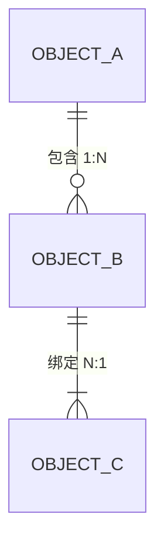

> 生成时间：{YYYY-MM-DD} | 最后更新：{YYYY-MM-DD}
> 所属：{组织 / 项目}
> 用途：全项目**唯一**术语真相源——业务本体（对象/关系/动作/规则）+ 业务术语 + 技术术语 + 别名禁令 + 维护指南
> 维护规则：改任一术语前先读 §八；🔴 条目**不得对外**；本文件是项目级主文档，分册与镜像以本文为准
> 置信度：🟢 已实测/客户原话 · 🟡 文档佐证 · 🔴 仅推断（宁低勿高）

# 项目级统一语言（Ubiquitous Language）

## 版本历史

| 版本号 | 更新时间 | 更新内容 | 更新人 | 关联工作项 |
|--------|----------|----------|--------|-----------|
| V1.0 | {YYYY-MM-DD} | 新建：八分区 + 本体 {N} 对象 / {N} 关系 / {N} 动作 / {N} 规则；抽取来源与路数 | {作者} | {触发事项} |

---

## 〇、怎么用这份文档

**三个动作**：

1. **查词** → Ctrl+F 搜本文，或看 §六 别名表（错写法反查正确写法）
2. **写材料** → 先查 §六（有没有禁止的写法）+ §七（易混淆词），再动笔
3. **改术语** → 直接看 §八 维护指南的「改一个词条要同步这些地方」

**按角色最少读法**：

| 角色 | 读哪几节 | 花多久 |
|------|---------|:--:|
| 新人第一天 | §〇 → §一 → §四 | 30 min |
| 开发 | §一（本体）→ §三（技术）→ §七 | 40 min |
| 产品 / PM | §一 → §五 → §七 | 25 min |
| 写对客材料 | §六 → §七 → 全文扫一遍 🔴 条目 | 15 min |
| 写会议纪要 | §〇 → §六 → 人名另册（用 `stakeholder-register` 技能） | 10 min |

> **看到 🔴 就别对外说**——🔴 = 从命名或上下文推测，无一手来源。对外版生成时会自动剥离。

---

## 一、业务本体（{域}）

> 本体 ≠ 词表：词表答「这个词什么意思」，本体答「世界里有什么东西、它们怎么连、谁能对它做什么、什么不能做」。
> **置信度口径**：🟢 = {本项目实测来源，如「客户演示的页面截图」「原系统页面」}｜🟡 = 只在需求条目/术语表被描述，无实证｜🔴 = 从字段或业务语义反推。
> **全局打折事实（有就写，没有删）**：{如「旧系统无设计文档」「源码未到位」→ 决定了本节的置信度上限}。


<details><summary>图的源码（mermaid，改图用）</summary>



</details>

### 1.1 对象类型（Object Types，{N} 个）

**{子域一}**

| 对象 | 中文 | 定义 | 关键属性 | 数据载体（现状 → 目标） | 置信度 | 出处 |
|------|------|------|---------|----------------------|:--:|------|
| {Object} | {中文名} | {一句话能独立读懂} | {属性1、属性2、属性3} | `{表名}` | {🟢/🟡/🔴} | {文件 §节} |

**{子域二}**

| 对象 | 中文 | 定义 | 关键属性 | 数据载体 | 置信度 | 出处 |
|------|------|------|---------|--------|:--:|------|

### 1.2 关系（Links，{N} 条）

| # | 源对象 | 关系 | 目标对象 | 基数 | 说明 | 置信度 | 出处 |
|:--:|--------|------|----------|:--:|------|:--:|------|
| L-01 | {源} | {动词短语} | {目标} | {1:1 / 1:N / N:M} | {为什么这样连，业务语义} | {级别} | {出处} |

### 1.3 动作（Actions，{N} 个）

> 写法 = 谁能对什么做什么。主体：{列出本项目的角色缩写，如 ADMIN / ENGINEER / SYSTEM}。

| # | 动作 | 主体 | 作用对象 | 前置 → 后置效果 | 置信度 | 出处 |
|:--:|------|------|----------|----------------|:--:|------|
| A-01 | {动词短语} | {角色} | {对象} | {什么条件下可做} → {做完系统变成什么样} | {级别} | {出处} |

### 1.4 业务规则（Rules，{N} 条）

| 编号 | 规则 | 触发场景 | 违反后果 | 置信度 | 出处 |
|------|------|---------|---------|:--:|------|
| R-01 | {一句话：什么不能做 / 必须满足什么} | {什么时候会撞上} | {系统行为：报错码 / 拒绝 / 静默修正} | {级别} | {出处} |

> 规则编号优先**复用系统既有错误码**（如 `{CODE_NAME} {编号}`），不另造一套。

### 1.5 状态机（{N} 个）

**5.1 {状态机名}（{载体字段}）**

```
（初始）→ {状态A} ──「{流转条件}」──▶ {状态B}
              │                              │
              └─ {该状态下的可写范围}         └─ {该状态下的可写范围}
```

全量枚举是否已穷尽：[待确认] / ✅。出处：{出处}。

---

## 二、业务术语词表

> 只收**业务概念词**。技术实现词 → §三；人名 → 另册；一个概念只在本表出现一次。

| 术语 | 英文 / 全称 | 定义（一句话能独立读懂） | 别名 | 置信度 | 出处 |
|------|------------|------------------------|------|:--:|------|
| {术语} | {English} | {定义} | {常见误写，详见 §六} | {级别} | {出处} |

---

## 三、技术术语

> 分区原则：**As-Is（旧系统）与 To-Be（新系统）分列**——同一个词在两边的含义可能完全不同（如某组件旧版有、新版无）。

### 3.1 As-Is（旧系统）

| 术语 | 含义 | 备注 | 置信度 | 出处 |
|------|------|------|:--:|------|

### 3.2 To-Be（新系统）

| 术语 | 含义 | 备注 | 置信度 | 出处 |
|------|------|------|:--:|------|

### 3.3 环境与工具链

> **写具体协议名，不写「免费」**——「免费」会被读成「有门槛的免费版」。
> 例：`Apache 2.0` / `GPLv2+CE` / `专有订阅`，不写「免费」「开源」（除非确指开源许可）。

| 工具 / 组件 | 版本 | 许可 | 用途 | 置信度 | 出处 |
|------------|------|------|------|:--:|------|

---

## 四、组织与角色

> **只收角色，不收人名**——人名转写校正走另一册（`stakeholder-register` 技能）。冲突时以项目周报/项目全景为准。

| 角色 | 归属方 | 职责 | 决策权 | 出处 |
|------|--------|------|--------|------|

---

## 五、商务与管理

| 术语 | 含义 | 口径要点 | 置信度 | 出处 |
|------|------|---------|:--:|------|

> **口径类词条必须写全链路**。例：「{阶段A}（{收费形态}）→ 成功后 {阶段B}（{收费形态}）」——只写一半会被读成口径冲突。

---

## 六、别名与禁止词

> 标准写法在左，**禁止写法在右**。用途：写材料前查一遍，写完 grep 一遍。
> 「状态」列：✅ 已闭环｜⚠️ 待修正｜❌ 已作废｜`[待确认]` 未定。

| 标准写法 | 禁止写法 | 为什么禁 | 状态 |
|---------|---------|---------|:--:|
| {正确写法} | {错误写法} | {原因：语音误转 / 历史误记 / 跨文档漂移} | ✅ |

**三个来源**：① 语音转写错词（纪要/逐字稿实测出现）② 历史误记（曾写错、后被纠正）③ 跨文档漂移（同一概念在不同文档的不同写法）。

> ⚠️ **口径冲突不静默择一**——两份材料说法不一且都未闭环时，**两列都写上**，状态标 `[待确认]`，并在「存疑清单」登记待谁核。

---

## 七、易混淆词辨析

> 每组写清「差在哪」，不写「注意区分」这类废话。

| 组 | A | B | 差在哪 | 用哪个 |
|:--:|----|----|--------|--------|
| 1 | {词A} | {词B} | {一句话说清边界，如抽象/实现、内部/对外} | {场景 → 选谁} |

---

## 八、维护指南

### 8.1 置信度标准（改词条前先看这）

| 标记 | 含义 | 判据 | 能对外说吗 |
|:--:|------|------|:--:|
| 🟢 | 已实测 / 客户原话 | 有可指认的一手来源（逐字稿行、原系统页面、命令输出） | ✅ 可以 |
| 🟡 | 文档佐证 | Spec / 纪要 / 设计文档有明确记载，但未实证 | ⚠️ 需复核 |
| 🔴 | 仅推断 | 从命名或上下文推测，无直接来源 | ❌ 不可 |

**执行规则**：① **宁低勿高**——拿不准就降一级 ② **可升级**——实证后改级别并在版本历史留痕 ③ **🔴 隔离**——对外版本生成时自动剥离。

### 8.2 改一个词条，要同步这些地方

> **不是「我觉得改完了」，是「我 grep 过，确认零残留」。**

| 你改了什么 | 必须同步 | 怎么验 |
|-----------|---------|--------|
| 主文档任一术语 | {镜像文件路径} | `diff` 比对 |
| {域}对象 / 关系 | {设计文档 ER} + {分册路径} | 交叉阅读 |
| 新增禁止别名 | 全仓 grep 旧写法 | `grep -rn "<旧写法>" .` 零命中 |
| 术语改标准写法 | 见 §8.3 引用面清单 | 逐处确认 |
| 人名 | 另一册（`stakeholder-register` 技能） | 不在此表 |

### 8.3 引用面清单（改名前必看）

| 文件 | 引用处数 |
|------|:--:|
| {文件路径} | {N} |

> **合计 {N} 处 / {N} 文件。** 引用面大时**不改文件名**——改名收益 < 断链成本。

### 8.4 分层结构（谁是真相源）

```
L0 主文档（本文件，唯一真相源）
   · 管：项目级全部术语 + {域}对象/关系/动作/规则
        │
        ├─ L1 分册：{路径}（{域}深水区，顶部声明主文档优先）
        ├─ L1 分册：{路径}（人名转写校正，与人名工具配套）
        └─ L2 镜像：{路径}（离线/纯净环境，内容从主文档单向同步）
```

**冲突时以主文档为准。**

### 8.5 新增术语的三步

1. **查重**——先搜本文档，别造第二份
2. **定位**——放哪个分区？带出处了吗？置信度是几级？
3. **同步**——按 §8.2 表格逐项同步 + grep 复扫

### 8.6 自动维护

用 `ubiquitous-language` 技能：说一句「抽一下项目术语」或「更新统一语言」，它会扫全仓 → 抽术语 → 标置信度 → 更新本文 → 复扫影响面。**手工维护的术语表一定腐烂——这是这个技能存在的唯一理由。**

---

## 附录：本体存疑清单

> 本清单是**下一步行动清单**——把「不知道」变成「待办」。

| # | 存疑点 | 为什么存疑 | 怎么核实 | 待谁 |
|:--:|--------|-----------|---------|------|
| 1 | {存疑点} | {无一手来源 / 两份材料冲突} | {索要样张 / 查源码 / 问对接人} | {人} |
